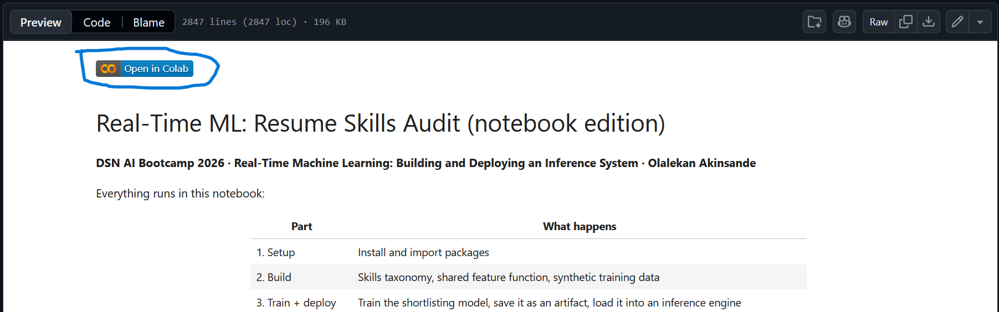

# DSN_AI_Bootcamp_2026
## Real-Time Machine Learning: Building and Deploying an Inference System  · Olalekan Akinsande
This Github repository contains the codebase for the session.

### How to run 
you can run the notebook with google colab or on your local machine
- Google colab (Recommended)
you can run the notebook on google colab by clicking the `Open in Colab` icon at the top of the notebook in github then clicking save copy to google drive (so as to save your own changes)

- local machine
first you have to download the notebook to your local machine then if you have the [anaconder](https://www.anaconda.com/download/success?reg=skipped) software open it and select jupyter notebook then using jupyter notebook navigate to your downloads file and select the notebook file

